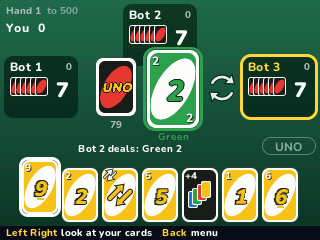

> **UNO is a [NumPlay](../../README.md) game that comes on its own.** It is too big to fit next to NumPlay on the calculator. Get `UNO.nwa` from the [latest release](https://github.com/Mason363/NumPlay/releases/latest).

  

<h1 align="center">UNO</h1>

  <b>The card game against one to three bots, on the NumWorks calculator.</b> 
  The official rules, the 108-card deck and scoring to 500 points.

  <a href="https://github.com/Mason363/NumPlay/releases/latest/download/UNO.nwa"><b>Download UNO.nwa</b></a>
  &nbsp;·&nbsp; <a href="#controls">Controls</a>

  

## Highlights

* **The official rules:** the 108-card deck, Skip, Reverse, Draw Two, Wild and Wild Draw Four, with the first card's effect, drawing a card you may play at once, and the two-player rules (Reverse and Skip let you play again).
* **The Wild Draw Four challenge:** it's only allowed with no card of the colour in play, but anyone can bluff. Challenge it and see the hand: a bluffer draws 4, otherwise you draw 6.
* **UNO!** Say it as you play your next-to-last card. Forget, and a bot may catch you for 2 cards. Catch a bot that forgot.
* **Scoring to 500:** the winner of each hand scores the cards left in the others' hands, and the deal moves to the left, until someone has 500 points. Or play a single hand.
* **Bots at three levels:** Easy plays any card that goes; Normal saves its Wilds and stops a player about to go out; Hard also counts the cards it has seen, plays to the colours you lack and may bluff.
* **House rules, if you want them:** stacking Draw Twos or Wild Draw Fours, drawing until you can play, having to play a drawn card, and UNO said for everyone. All off by default.
* **Saved as you go:** Home saves and quits, from anywhere. Your game is also copied into `uno_saves.py`, so installing the app again doesn't erase it.

<table>
  <tr>
    <td align="center"> Your turn: the cards that go are lit</td>
    <td align="center"> A Wild: call a colour</td>
  </tr>
  <tr>
    <td align="center"> A Wild Draw Four: take it or challenge</td>
    <td align="center"> The challenged hand, shown to you</td>
  </tr>
  <tr>
    <td align="center"> Two cards left: time to say UNO</td>
    <td align="center"> A hand won, on the way to 500</td>
  </tr>
  <tr>
    <td align="center"> A new game: players, bots, length and house rules</td>
    <td align="center"> The title screen</td>
  </tr>
</table>

## How to play

Match the top card of the discard pile by colour, number or symbol, or play a Wild, which goes on anything. You can also draw a card instead; if it goes, you may play it at once. The coloured frame round the discard pile shows the colour to match, also after a Wild.

Skip makes the next player miss a turn, Reverse turns play round, and Draw Two makes the next player draw 2 and miss a turn. With a Wild you call the colour. A Wild Draw Four also makes the next player draw 4 and miss a turn, and it's only allowed when you have no card of the colour in play. The next player may challenge it: if it was a bluff, its player draws the 4; if not, the challenger draws 6.

Press **shift** as you play your next-to-last card, to say UNO. If you forget, anyone who catches you before the next player starts makes you draw 2; say it in time and you're safe. When a bot forgets, **shift** catches it. The first to play all their cards wins the hand and scores the cards left in the others' hands: numbers at face value, Skip, Reverse and Draw Two 20, Wilds 50. The first to 500 points wins the game.

## Controls

| Key | What it does |
| --- | --- |
| Left and Right | Pick a card in your hand |
| OK | Play the card |
| Up | Draw a card, keep the card you drew, or take the cards you have to |
| shift | Say UNO, or catch a bot that forgot |
| Back | Pause (Resume, New game, How to play, Quit game) |
| Home | Save and quit |

## Good to know

* **On its own:** UNO is too big to fit next to NumPlay. Installing it from the NumWorks website swaps out NumPlay and the other apps, and installing NumPlay again swaps it back out.
* **The classic deck:** the 108 cards of the classic game, without the blank cards and Wild Shuffle Hands of newer decks.
* **The table:** you and one to three bots. The original takes up to ten players.

## Credits

Inspired by [UNO](https://www.mattel.com/brands/uno), the card game by Mattel, not affiliated with Mattel. Go play the original with your friends, or the official app.

* The rules and scoring follow Mattel's instruction sheet. The cards are drawn by the game itself, after the classic deck's look, and the text uses NumPlay's **Nunito** font (SIL Open Font License).
* The calculator adaptation is by **Bobydeluxe**, who brought it to NumPlay.

Made by Mason Chen as part of NumPlay.

## License

The game's code is licensed under the GNU General Public License v3.0: see the `LICENSE` file at the root of the repository. UNO is a trademark of Mattel.
