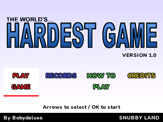
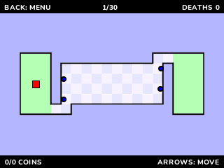

# The World's Hardest Game for NumWorks

A native adaptation of **Snubby Land's original version 1.0**, with all **30
levels**, for N0110, N0115 and N0120. Adapted by **Bobydeluxe**. Everything in the
game is in English.




Move the red square through each maze, avoid the enemy circles, collect every
yellow coin and reach the green finish. Other green regions are checkpoints.
Deaths are unlimited; fewer deaths is a better score. A death removes that
level's collected coins and returns the player to the latest checkpoint.

The stage layouts, checkpoints, visible coins, palettes and enemy trajectories
come from the original Flash game, rather than newly invented levels. Player
movement retains its original three pixels per 30 Hz step, including independent
diagonal movement. The original five collision probes and inset wall probes are
preserved. Obstacles continue moving during the original death fade. The three
advice screens and stage announcements are retained.

## Install and play

Install **WorldsHardestGame.nwa** with the NumWorks external-app installer.

| Key | Action |
| --- | --- |
| Arrows | Move the square; select menu options |
| OK | Select; advance an advice screen or skip a stage announcement |
| EXE on the home menu | Start a new run, with confirmation if one exists |
| Back | Pause, return or cancel |
| Home / Power | Save and exit safely |

The pause menu offers Resume, Retry checkpoint, How to play, Main menu and Quit
game. Retry checkpoint counts as a death. Pausing freezes the enemy cycles too.
Continue resumes the saved square position, coins, checkpoint, death count and
enemy phase. Starting a new run keeps completed-run records.

## Calculator changes

The 550 x 400 original scene is scaled to the calculator's 320 x 240 screen.
The title uses the original artwork; interactive text uses native antialiased
fonts. Board rows share a compact 32-colour palette. Local completed-run records
replace the website's online leaderboard, and the web-link buttons become How to
play and Credits. A pause menu and saved Continue are added. There is no audio:
NumWorks calculators have no speaker. This is a native adaptation, not a Flash
emulator or a claim of pixel-identical output on a smaller screen.

`whg.sav` is a versioned, CRC-checked **72-byte** profile. `whg_save.py` is its
inert hexadecimal backup in comments. The NumWorks installer preserves Python
scripts, so keeping this script lets progress return after an app reinstall.
It is never executed. A full calculator reset deletes both. Full storage offers
retry, return, or an explicit exit without saving; other files are preserved.

All stages and animation data stay in flash. The game uses a 10 KiB drawing strip
and fixed-size state, without a framebuffer, decoded atlas, heap or runtime
download. Logic runs at the original **30 Hz**, independently of drawing speed.
Static menus and advice pages redraw only when needed.

See [validation](docs/validation.md) for measured sizes, timing and test limits,
and [reference data](docs/reference.md) for provenance and regeneration.

## Build and test

Requirements: ARM GCC with newlib, nwlink 1.0.0, Python 3 with Pillow,
pyelftools and Unicorn 2.1.4, plus a C compiler for host tests.

```sh
make -C games/worldshardestgame build NWLINK=nwlink
make -C games/worldshardestgame test
make -C games/worldshardestgame test-arm NWLINK=nwlink
```

`PYTHON`, `TOOLCHAIN`, `HOST_CC` and `NWLINK` can be supplied to Make. The release
output is `games/worldshardestgame/output/WorldsHardestGame.nwa`.
The generated tables are included: JPEXS and the original SWF are not required
to compile or play. It is a separate download in NumPlay's big-game section, outside the default launcher and customizer kit. From the repository root, `make build/data/apps/WorldsHardestGame.nwa` or `python tools/build.py --game worldshardestgame` builds it.

## Credits

- **Stephen Critoph / Snubby Land** created The World's Hardest Game; **Armor
  Games** published it. Original levels, trajectories, title and visual design
  remain credited to their creators. [Original game](https://armorgames.com/play/1043/the-worlds-hardest-game).
- Original music by **Snayk** and sounds credited to **Flashkit.com**; neither is
  installed in this adaptation.
- Native adaptation, controls, save system and tests by **Bobydeluxe**.
- NumPlay supplies its strip renderer, fonts and firmware/file helpers under
  GPL-3.0. The original game's materials retain their original ownership.

This unofficial adaptation is not affiliated with Snubby Land or Armor Games.
